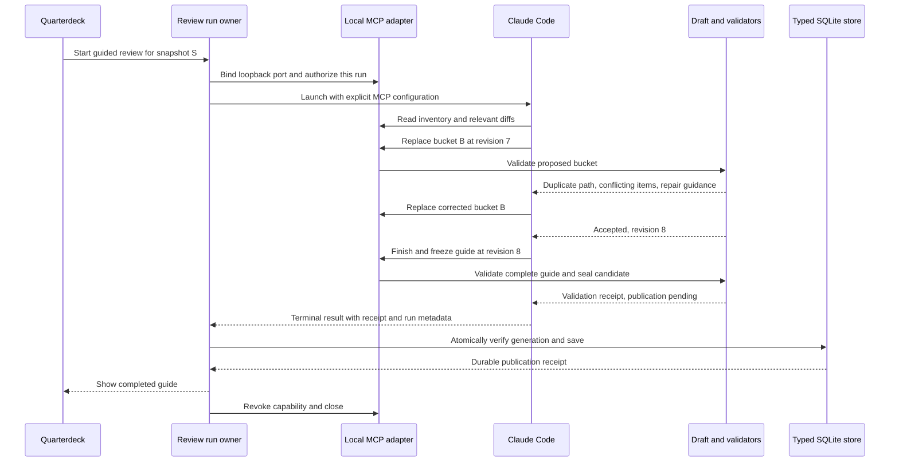

# A per-run MCP bridge for guided reviews and briefs

Implementation update (15 November 2026): Guided review and Brief now use the per-run official Rust SDK transport, repairable bucket/page drafts, sealed receipts and generation-checked SQLite publication. Both repair loops passed real-Claude probes on synthetic inputs. See [the measured spike results](guided-review-mcp-spike.md), [the transport](../../crates/agent_mcp/README.md), and [the studio implementation](../../crates/studio/src/README.md). The analysis below records the research and decisions that led to that implementation.

Research date: 2026-11-15. Decision proposal, not an implemented feature. Evidence combines current primary protocol/SDK sources, the installed Claude CLI, isolated localhost probes, and Quarterdeck's current source. The companion investigations are [protocol](mcp-protocol-current.md), [Claude integration](claude-mcp-per-run.md), and [application contracts](mcp-review-contracts.md).

## Recommendation

Build a small, per-run MCP interface around Quarterdeck's real review validators. Use an app-owned Streamable HTTP endpoint bound to `127.0.0.1:0`, a fresh run-scoped credential, and explicit Claude CLI configuration. Keep drafts separate from the last usable guide or brief. Give Claude precise validation results while it is still working, then publish only through an application-controlled, atomic commit.

The main benefit is a repair loop with authoritative application feedback. Transport alone does not establish correct file membership, valid code anchors, complete coverage, or permission to publish. Those rules remain typed Rust code shared by the MCP tools, tests, and persistence boundary.

Start with guided review buckets, then reuse the run lifecycle and publication contract for brief pages. Avoid a generic UI-editing API or widget-by-widget patch language. A bucket and a brief page are useful replacement units: they are small enough to repair and large enough to validate coherently.

## Why the reported error cannot currently repair itself

`parse_smart_buckets` expands selectors against the actual changed-file inventory and rejects a file repeated across two items in the same bucket. A folder selector and a more specific selector can therefore conflict even when their submitted strings differ. Repetition inside one item is deduplicated; overlap between different buckets is currently allowed. These are application semantics, not just JSON shape checks. The generator invokes this Rust validation only after `run_smart_filter` returns the final structured answer. Its error is then displayed in the app, with no request back to that agent. [Validator](../../crates/studio/src/smart_filter.rs), [generation job](../../crates/app/src/pull_request_detail/smart_filter_job.rs), [detailed source trace](mcp-review-contracts.md)

The brief has the same missing feedback channel. The Rust parser checks anchors and widget constraints after generation; it can discard invalid widgets and record rejections, but the authoring agent does not receive those checks during composition. Exposing the existing checks as tools would let it correct a bad anchor, graph, or page before publication. [Brief job](../../crates/app/src/pull_request_detail/brief_job.rs), [brief parser](../../crates/studio/src/parse_studio.rs)

## Current protocol and client baseline

| Component | Verified baseline | Design consequence |
|---|---|---|
| MCP core | Stable revision `2026-07-28` | Design for modern discovery and per-request metadata; keep application state explicit. |
| Older MCP | `2025-11-25` remains relevant to compatibility | Let the SDK handle the older lifecycle; do not make a transport session the review's identity. |
| Installed Claude Code | `2.1.325` | Local synthetic probes can verify launch behavior without sending repository data or paying for a model run. |
| Official Rust SDK | `rmcp` release `3.10.0`, published November 12 | Use a pinned, tested release; do not develop against a floating branch. |

The July protocol release replaced the initialization handshake and protocol sessions with discovery and per-request version/capability information. Modern HTTP no longer uses the independent GET stream or the previous stream-resumption mechanism. New interactions such as multi-round-trip input requests and the extensions framework must be distinguished from support actually advertised by a client. [Official release](https://blog.modelcontextprotocol.io/posts/2026-07-28/), [modern HTTP transport](https://modelcontextprotocol.io/specification/2026-07-28/basic/transports/streamable-http)

That changes the implementation substantially compared with the historical [review-studio proposal](ai-review-studio.md). Preserve the useful domain idea from that note, but re-verify its protocol and CLI examples. The separate [protocol investigation](mcp-protocol-current.md) records current capabilities, optional extensions, deprecations, and compatibility boundaries.

## Proposed conversation



The diagram is proposed application behavior. MCP defines the callable tool boundary; Quarterdeck defines the draft, revision, transaction, receipt, and cancellation ordering.

A proposed validation payload for the reported error:

```json
{
  "accepted": false,
  "draft_revision": 7,
  "issues": [
    {
      "code": "duplicate_file_in_bucket",
      "bucket_id": "persistence-tests",
      "path": "tests/migration_test.rs",
      "item_indexes": [0, 2],
      "message": "This file belongs to both items in this bucket.",
      "repair": "Keep it in one item, then replace this bucket again."
    }
  ]
}
```

The item indexes in this example are zero-based positions within the submitted bucket; v1 only needs stable IDs for buckets and pages.

Return domain failures as tool results with `isError: true`, a concise textual explanation, and structured details. Let the SDK emit the correct version-specific envelope. Tool execution errors are intended to be visible to the model; malformed protocol requests and unknown methods belong to the JSON-RPC error layer. Successful `outputSchema`/`structuredContent` support describes the server's result contract, rather than proving the model's proposed review is semantically correct. [MCP tools](https://modelcontextprotocol.io/specification/2026-07-28/server/tools)

The installed Claude probe exposed an important formatting detail: successful structured content becomes the model-facing result, while an explicit error uses its text diagnostic. Include every repair-critical code, path, conflicting item index, and instruction in the error text, even when also returning structured data. Likewise, put required success instructions in the structured success result rather than only in accompanying prose. [Observed result mapping](claude-mcp-per-run.md)

The model may repair the result, but its cooperation is not a correctness guarantee. Finalization must run the required checks. Claude exiting successfully or saying “done” is insufficient without a server-issued validation receipt bound to the exact sealed candidate; the app still has to save it successfully.

## Keep the tool surface small

These names and payloads are proposals, not existing APIs.

| Tool family | Responsibility |
|---|---|
| `review_context`, `review_files` | Return snapshot identity, stack layers, file metadata, and a paginated inventory with stable file identifiers. |
| `review_diff`, `review_text` | Return bounded, numbered excerpts from the frozen base/head snapshot, with explicit unavailable/binary states. |
| `guide_replace_bucket` | Validate and atomically replace one complete bucket, with ordered reading items and exact resolved membership. |
| `guide_get_draft`, `guide_validate` | Read accepted draft state; report remaining coverage, order, membership, and guidance issues. |
| `guide_finish` | Submit an expected draft revision and explicit ordered bucket list, validate the whole guide, freeze it, and return a receipt with publication still pending. |
| Later: `brief_replace_page`, `brief_validate`, `brief_finish` | Apply the same lifecycle to complete pages, including anchor and widget validation. |

For a first compatibility experiment, one `validate_guide` tool accepting a complete candidate is enough to prove repair. For production stacks with thousands of files, resend only the invalid bucket or page. A stable `bucket_id` is separate from display order; finalization specifies order explicitly. Do not infer order from parallel HTTP arrival times.

The initial write tools should affect draft data only. Existing human controls remain responsible for viewed marks, GitHub reviews, merges, and branch deletion. A guide may suggest grouping or acknowledgement; generation should not mark files viewed.

Read tools are useful for authoritative inventories, deleted files, combined-stack ranges, and valid anchor windows. They can be introduced alongside the existing confined checkout reads. Moving every code read behind MCP is a separate tradeoff: it simplifies the app's authority boundary but adds pagination/tool-call overhead and must preserve the ability to inspect surrounding source.

## Draft, publication, and concurrency rules

1. **Freeze the input.** Bind the run to repository, review scope, base and head commits, changed-file inventory, and brief reader settings. A refresh creates a new snapshot rather than silently altering an active run.
2. **Use application identities.** Mint a run ID, generation token, and draft ID independent of any MCP connection. A reconnect does not create a new draft.
3. **Make replacements transactional.** Reject an invalid replacement without changing the last accepted unit. Return several useful issues together, including concrete paths and conflicting items, instead of failing with one unlocated string.
4. **Protect retries.** Mutations carry an operation ID and expected revision. Repeating the same accepted operation returns its original receipt; reusing its ID for different content is an error. JSON-RPC IDs correlate requests and do not provide these guarantees.
5. **Serialize publication.** The same application owner must order cancellation, supersession, and commit. Recheck the active generation and snapshot while establishing the commit, rather than checking an atomic flag before a later database lock.
6. **Preserve usable output.** Keep the previous committed guide or brief visible on a failed rewrite. Partial accepted draft content may be shown as a preview, but should not masquerade as a completed artifact.
7. **Separate readiness from durability.** An idempotent finish call returns the same validation receipt if its response is lost. Only the host transaction creates a durable publication receipt. Retrying that host publication must not duplicate it or erase a durable result.
8. **Keep agent delegation read-focused initially.** The coordinator replaces buckets/pages. Shared MCP credentials do not identify which subagent made a request. If writer isolation cannot be enforced through verified CLI tool configuration or separate capabilities, treat all holders as authorized writers and rely on explicit serialization/revision checks.

For the first production version, keep durable publication after the CLI terminal result. `guide_finish` / `brief_finish` return a readiness receipt with `publication_status: "pending"`; they do not claim the artifact has been saved. The successful terminal result must reference that sealed receipt. The host can then record the complete cost, model, session, and transcript together with the artifact. An explicit durable commit tool is a later option, but it would require provisional run metadata and a committed state that survives a later CLI failure. It provides no additional repair benefit for the first version. [Current final-result metadata boundary and recommended publication contract](mcp-review-contracts.md)

Cross-bucket membership remains legal under the existing guide contract. Coverage checks should use a set of covered files; progress remains tied to the actual files, not the number of references. Changing that policy would be a separate product decision. [Current contract and race analysis](mcp-review-contracts.md)

## Random-port lifecycle

Use the OS-assigned port from a listener already bound to `127.0.0.1:0`. Do not find a free port, close it, and later reopen it. Wait for the endpoint to be ready before starting Claude. A random port avoids collisions; a run-scoped credential supplies authorization.

Generate a fresh high-entropy capability for each run. Limit it to the frozen snapshot and permitted tools. Prefer an ephemeral configuration containing environment placeholders, with the actual token supplied through the child environment. Keep tokens out of command arguments, report bundles, transcripts, and logs. Private configuration files, if used, belong outside the reviewed checkout and are removed on cleanup.

Bind only to loopback, validate the request authority/Host and permitted Origin, require the credential on every call, and apply bounded request sizes. Do not grant a generic filesystem, shell, or GitHub mutation API. Localhost credentials protect this API from unrelated clients and web-origin attacks; they are not isolation from an already compromised process running as the same desktop user. Origin validation and loopback binding are specifically relevant to local MCP HTTP servers. [Transport security guidance](https://modelcontextprotocol.io/specification/2026-07-28/basic/transports/streamable-http#security--endpoint)

This pre-shared local capability is a Quarterdeck-specific authentication scheme. It does not implement MCP’s optional OAuth discovery/registration profile or promise general OAuth interoperability. [Authorization scope](https://modelcontextprotocol.io/specification/2026-07-28/basic/authorization)

The app owns the endpoint lifetime. On cancellation or replacement, first invalidate the generation/capability so late calls cannot finish or publish, then stop the Claude process tree and close active requests/listener, settle the run, and remove its private files/workspace. On normal completion, obtain the CLI terminal result and matching validation receipt, publish through the host, then tear down. A process exit without valid finalization becomes an incomplete run with its useful diagnostics retained.

Use per-call I/O deadlines and the existing user cancellation control. This design does not require restoring a dollar cap or introducing a blanket generation-duration cap. Test teardown on successful output, model failure, app close, explicit cancellation, and a child that ignores the graceful termination signal.

## Claude launch compatibility is a real migration

The installed CLI probe found that `--safe-mode` disables even an explicit `--mcp-config`: no connection occurs and the startup tool inventory has no MCP server. Removing only that flag permits connection. Thus appending MCP flags to the current command would silently fail to deliver the intended contract. [Probe evidence and current CLI documentation](claude-mcp-per-run.md)

Do not replace it with `--bare` without accounting for authentication and tool changes. In the inspected version, bare mode does not use the existing subscription/OAuth credentials and the startup tool inventory differs from the app's current read/delegation setup. [CLI evidence](claude-mcp-per-run.md)

A narrower candidate passed the isolated startup/customization probes:

```text
--restricted
--disable-slash-commands
--setting-sources ""
--settings '{"claudeMdExcludes":["**"],"disableAllHooks":true,"autoMemoryEnabled":false}'
--strict-mcp-config
--mcp-config <private-run-configuration>
--permission-mode dontAsk
--permission-prompts none
```

For this small fixed tool set, use the tested `ENABLE_TOOL_SEARCH=false` setting so required schemas are available directly. Detect inherited `CLAUDE_CODE_SAFE_MODE=1`, bare-mode activation through `CLAUDE_CODE_SIMPLE=1`, or managed configuration that prevents the required server; do not proceed as though validation tools were available.

Use structured process arguments, not a shell-concatenated command. Retain the appropriate `--tools` and exact `--allowedTools` list. The tested configuration keeps Read/Grep/Glob/Agent and explicit MCP. Seeded parent/project/user instruction files, nested instructions, skills, agent definitions, plugin content, and SessionStart hooks did not load or execute under this configuration; the positive control did load them. This is evidence for the tested local environment, not proof of equivalence to safe mode under every managed policy. Managed instructions/hooks and real subscription authentication still need targeted compatibility coverage. [Reproducible probe matrix](claude-mcp-per-run.md)

The per-run configuration shape was also tested with environment expansion:

```json
{
  "mcpServers": {
    "quarterdeck": {
      "type": "http",
      "url": "${QUARTERDECK_MCP_URL}",
      "headers": {
        "Authorization": "Bearer ${QUARTERDECK_MCP_TOKEN}"
      }
    }
  }
}
```

The installed client tried `server/discover` with revision `2026-07-28`; a synthetic legacy server's unknown-method response triggered fallback to `initialize` at `2025-11-25`. Separate scripted model-response tests exercised modern tool calls, explicit error feedback, output-schema failure, allowlist denial, and one subagent's inherited tool access. These used a local fake model endpoint and dummy credentials: they prove CLI plumbing, not autonomous model repair or live account authentication. [Local observations](claude-mcp-per-run.md)

Preserve explicit server configuration, strict MCP configuration, restricted built-in tools, noninteractive permission handling, and the existing subscription login path. Use exact allowed MCP tool names for the small production contract. Keep the previous JSON-schema output path behind a rollback mechanism while the MCP path is piloted. The new path needs only a small final structured validation receipt, not a second copy of the complete artifact; host publication uses the sealed draft.

## Rust integration and the no-Tokio rule

The official Rust SDK's current tagged release is `rmcp-v3.10.0`. Its manifest has a non-optional Tokio dependency; disabling default features does not make it a runtime-free JSON-RPC library. Its published minimum Rust version is 1.88. [Release](https://github.com/modelcontextprotocol/rust-sdk/releases/tag/rmcp-v3.10.0), [crate manifest](https://github.com/modelcontextprotocol/rust-sdk/blob/rmcp-v3.10.0/crates/rmcp/Cargo.toml), [workspace manifest](https://github.com/modelcontextprotocol/rust-sdk/blob/rmcp-v3.10.0/Cargo.toml)

This conflicts with Quarterdeck's current explicit “No tokio” convention. A maintained SDK is still the preferable direction, but adopting it requires an intentional, narrow convention change. It must not arrive as an unnoticed transitive implementation detail. [Current repository boundary](../../CLAUDE.md)

| Integration choice | Assessment |
|---|---|
| Official SDK on a dedicated transport thread | Smallest direct integration with existing in-memory run state and foreground channels. Requires a scoped Tokio exception; no runtime or blocking calls on the GPUI thread. |
| Official SDK in a bundled helper process | Keeps the runtime outside the GUI process and gives explicit process ownership. Adds an app/helper control channel, startup protocol, packaging, and signing responsibilities; still requires documenting the repository exception. |
| Custom blocking MCP implementation | Fits the current runtime rule, but makes Quarterdeck own evolving protocol negotiation, transport validation, cancellation, compatibility, and conformance. Do not choose this solely to avoid one dependency. |
| stdio MCP helper | A valid alternate transport, especially when Claude owns server lifetime. For an app-owned run, shared draft state and UI updates still need an app/helper link. It is worth comparing in a spike, but loopback HTTP directly matches the proposed ownership model. |

**Proposed default:** official SDK in a narrow transport adapter on a dedicated thread, with a blocking start/stop handle for the app and typed channels into the run owner. This has fewer moving parts for the first implementation. Choose a helper process instead if process-level fault isolation or packaging measurements justify its extra control channel. Both preserve UI-free domain validators and the existing GPUI background-to-foreground event pattern.

The SDK documents modern and legacy protocol support and a Streamable HTTP service that can emit plain JSON for short tool calls. Keep draft state in an application-owned shared handle captured by the service factory, rather than in a new handler instance created for each request. [Pinned SDK implementation guidance](https://github.com/modelcontextprotocol/rust-sdk/blob/rmcp-v3.10.0/README.md)

Its conformance roadmap reports both dated suites passing, while explicitly listing remaining extension failures and untested feature surfaces. That is useful evidence for choosing an SDK, not proof that every optional capability works with Claude or Quarterdeck. [Pinned conformance status](https://github.com/modelcontextprotocol/rust-sdk/blob/rmcp-v3.10.0/ROADMAP.md)

Record the final validation receipt separately from the accepted artifact and the proposal/validation history. In particular, the receipt must not silently replace the full answer currently represented by `BriefRecord.answer`. Reports should identify the frozen artifact, relevant rejected attempts, and the exact contract/guide/schema versions; transport credentials remain excluded.

Keep wire types separate from persisted domain types. JSON is appropriate for MCP requests/results; guides and briefs should continue to use the existing typed SQLite stores. Schema derivation and wire serialization should be confined to the adapter, with domain validation callable without MCP or a GUI.

## Capabilities to use and to defer

| Capability | First version |
|---|---|
| Tools with typed inputs/results and actionable errors | Essential. |
| Short request/response calls over Streamable HTTP | Preferred starting transport behavior. |
| Bounded read tools and paginated file inventory | Useful immediately for large stacks and exact identifiers. |
| App preview/progress events | Use typed internal channels; do not depend on a client rendering protocol notifications. |
| Resources/prompts | Optional discoverability conveniences after the tool contract works. |
| Sampling | Unnecessary for an already-running authoring agent. |
| Elicitation / multi-round-trip interaction | Defer; noninteractive generation should report unresolved choices through the app's own run state. |
| Tasks and subscriptions | Defer unless a concrete long-running server operation needs them; check negotiated support and extension maturity separately. |
| Rich MCP app UI | Unnecessary for the existing native renderers. |

This is a product selection, not a claim that omitted capabilities are unavailable. The [protocol note](mcp-protocol-current.md) distinguishes current core behavior from optional extensions; the [Claude note](claude-mcp-per-run.md) records client-specific evidence.

## Implementation gates

1. **Compatibility spike:** isolated snapshot and fake credentials; confirm the only configured server is available, both supported protocol versions work, structured failures reach the tool-result channel, and repository instructions/hooks/plugins cannot load through the chosen launch configuration. Verify subscription-auth compatibility separately from API-key fixtures.
2. **One live synthetic repair:** intentionally submit two overlapping items, inspect the error, correct the bucket, and finish with a matching validation receipt. Repeat with a missing file and a bad brief anchor. A deterministic fake API proves transport and tool plumbing; it does not prove a model will understand and repair the diagnostics.
3. **Typed draft core:** aggregate precise issues, replace units atomically, paginate inventories, protect retries, and establish commit/cancel/supersede ordering. Tests use temp/in-memory data without GitHub or paid agents.
4. **Guided-review pilot:** preserve the old guide during work; preview accepted buckets; commit only complete output. Exercise a large combined stack with binaries, deleted/renamed files, and overlapping selectors.
5. **Brief integration:** reuse run ownership and receipts; add page-level validation and preserve the prior brief on failed rewrites. Revalidate code anchors against the frozen base/head snapshot.
6. **Operational checks:** cancellation, dropped responses, duplicate operation IDs, stale generations, lost commit receipts, parent/child crashes, listener cleanup, and no credential leakage. Run standard repository checks and native UI checks with `--no-splash` when implementation starts.

The architecture is feasible and directly addresses the reported feedback gap. The next useful work is a small compatibility-and-repair spike, followed by the typed guided-review contract; a broad MCP feature platform is unnecessary for this result.
